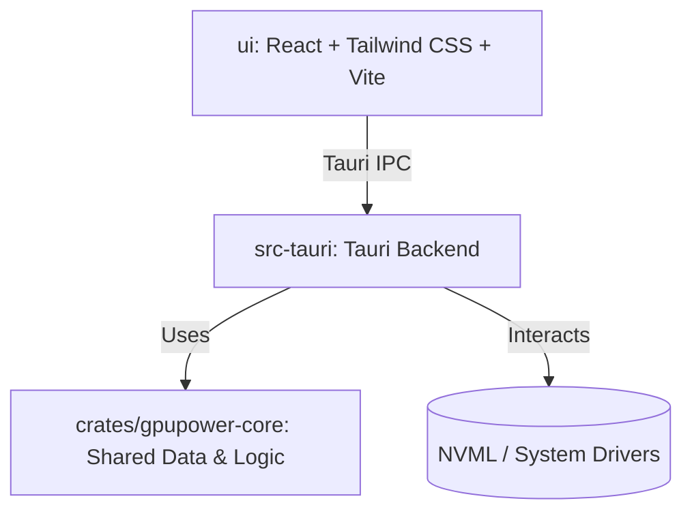

# Grok GPU Power

A Tauri application to monitor and limit GPU power consumption with a system tray interface.


<!-- SCREENSHOT PLACEHOLDER: hero image of the system tray menu and power graph -->
_Screenshot coming soon._

## Features

- Reads and displays real-time GPU power usage via NVML.
- Provides a system tray interface for quick access.
- Allows users to set power limits as percentage or absolute watts.
- Records and exports power history to CSV or JSONL.
- Supports an elevated helper process for applying settings requiring administrative privileges.

## Architecture



The application is split into a React frontend (`ui`) and a Rust backend (`src-tauri`). The `gpupower-core` crate handles shared data structures, history recording, and helper communication. The backend communicates with NVML to read device power and apply limits.

## Quick start

To start development, ensure you have Node.js and Rust installed. You must run the Vite dev server and the Tauri backend in two separate terminals.

**Terminal 1 (Frontend):**

```bash
cd ui
npm install
npm run dev
```

**Terminal 2 (Backend):**

```bash
cd src-tauri
cargo run
```

To build for production, you must build the UI first so the output is placed in `ui/dist`, then build the backend:

```bash
cd ui
npm run build
cd ../src-tauri
cargo build --release
```

To run tests:

```bash
# Run backend tests
cargo test --workspace

# Run UI tests
cd ui
npm test
```

## Configuration

| Environment / File | Purpose | Default |
| --- | --- | --- |
| `APPDATA/GpuPower/settings.json` | Stores user-configured power limits and application settings. | N/A |
| `PROGRAMDATA/GpuPower/helper-stdout.json` | Path where the elevated helper writes result data. | N/A |

## Screenshots

<!-- SCREENSHOT PLACEHOLDER: screenshot of the settings dialog or the power limits interface -->
_Screenshot coming soon._

## Roadmap

See issues.

## License & credits

No license specified.
